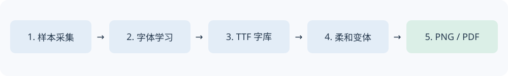

# Personal Handwriting Studio · 个人手写字体工作室

把自己的手写样本整理成字体，再生成自然、清楚的白底 A4 手写稿。

这是从一个真实个人字体项目中整理出的 **命令行工具与 AI 协作工作流**：采集 → 切字 → MX-Font 少样本学习/可选微调 → TTF → 五种柔和字形 → PNG/PDF。



## 能做什么

- 生成带字符标签与裁切坐标的 A4 样本采集模板。
- 从人工校正到模板尺寸的扫描页裁切单字，输出可检查的 manifest 和样字拼图。
- 使用独立获取的 MX-Font 预训练权重进行少样本风格推理；可选择真实梯度微调解码器。
- 训练/验证/测试按字符隔离，记录模型来源、指标及生成范围；真实样字可优先进入最终字体。
- 将样字/生成字形转换为 TTF，并导出 V0–V4 五套温和变体。变体属于几何后处理，**不等于重新训练**。
- 使用固定种子与五字形袋轮换，生成纯白 A4、300dpi PNG 和多页 PDF，保留 Unicode 文本与排稿记录。
- 对缺字或空白字形报错；不偷偷换成其他字体。

## 先看边界

此版本不是安装即得的个人字体模型：**你需要自己的样字、兼容的预训练权重，以及获得使用许可的结构参考字体**。仓库不包含原使用者的手写样张、个人字体、作业、训练参数，也不打包第三方字体或预训练权重。

模板照片的透视校正、字符标注和字形视觉检查需要人工参与。`render` 支持纯文本和 Unicode 数学符号；**不解释 LaTeX、不自动解题、不自动排分式/根号/积分图形，也不提供图像式公式布局**。原个人项目中的作业专用布局没有伪装成通用排版功能。

3500 常用字是建议的扩展目标，实际覆盖由 `--chars` 决定；训练不会自动创造可靠的3500字。先做20–50字试验、检查未见字效果，再扩大字库。[能力与来源说明](docs/PROJECT_STATUS.md)

## 安装

Python 3.10+；建议新建虚拟环境。Windows PowerShell：

```powershell
git clone https://github.com/tardugnofritsch-ui/personal-handwriting-studio.git
cd personal-handwriting-studio
python -m venv .venv
.venv\Scripts\Activate.ps1
python -m pip install -e .
handwriting --help
```

macOS/Linux 使用 `source .venv/bin/activate`。字体构建、模板和排稿不依赖 PyTorch。要使用 AI 步骤：

```sh
python -m pip install -e ".[ai]"
```

GPU 版 PyTorch 请按 [PyTorch 官方安装说明](https://pytorch.org/get-started/locally/)选择与你的系统匹配的版本。CPU 可以跑小规模流程，但完整字库微调会较慢。

## 最快开始：已有字体 → 手写稿

把你有权使用的 TrueType 字体保存到 `data/my-font.ttf`，文本保存到 `data/manuscript.txt`。字体必须覆盖文本中的所有非空白字符。

```sh
handwriting variants --font data/my-font.ttf --out generated/fonts
handwriting render --text data/manuscript.txt --fonts generated/fonts --out generated/manuscript
```

打开 `generated/manuscript/manuscript.pdf` 或 `page-001.png`。此路线只生成几何变体，**不会学习你自己的笔迹**。复合轮廓保持原样；CFF 格式 OTF 暂不支持变体。

## 完整路线：自己的样字 → 字体 → 手写稿

### 1. 采集与切字

准备字符列表 `data/chars.txt`（UTF-8，一个字符可出现多次，但模板会去重），以及用于显示标签的字体：

```sh
handwriting template --chars data/chars.txt --font data/source.ttf --out generated/templates
```

打印 `templates.pdf`，在空白区域写字。扫描后把页面人工对齐到对应 PNG 的2480×3508像素，不要把未经校正的手机照片直接裁切：

```sh
handwriting extract --scan data/scan-001.png --grid generated/templates/template-001.json --out data/samples
```

检查 `data/samples/review.png` 和 `manifest.json`，删掉错标、邻字、断笔或空白样本。多页请输出到不同子目录，再汇总 manifest；文件名不能相互覆盖。也可以自行裁好样字，按 [样本格式](docs/SAMPLES.md)创建 manifest。

### 2. 获取模型资源

本工具内置 MX-Font 网络代码的带许可副本，**不包含模型权重**。从 [MX-Font 官方项目](https://github.com/clovaai/mxfont)获取兼容 `generator.pth`，存入 `checkpoints/generator.pth`；参考其官方推理笔记本及资源说明。不要使用未知来源的 pickle 模型。本工具采用 `weights_only=True` 加载。

结构参考字体请自行合法获取，例如上游实验使用的 Ma Shan Zheng。保存为 `data/source.ttf`，它必须覆盖目标字符与所有样字字符。缺字时会明确报错。

### 3. 小规模学习与可选微调

先用小字符表测试推理：

```sh
handwriting learn --manifest data/samples/manifest.json --checkpoint checkpoints/generator.pth --source-font data/source.ttf --chars data/chars.txt --out generated/learning
```

默认 `--steps 0`：预训练少样本推理，没有进行新训练。确认样字标签与生成效果后，至少提供10个不同字符的样字，再试真实微调：

```sh
handwriting learn --manifest data/samples/manifest.json --checkpoint checkpoints/generator.pth --source-font data/source.ttf --chars data/chars.txt --out generated/learning --steps 100 --seed 19
```

检查 `training.json` 和 `glyphs/`。微调保留验证损失最好的解码器（含训练前模型），不保证一定改善。真实样字按字符分组隔离，验证/测试字不进入训练样本和风格参考；生成目标字的结构信息可以使用参考字体。训练采用真实样字监督与冻结教师的结构约束。详细说明见 [训练说明](docs/TRAINING.md)。

### 4. 导出字体与覆盖检查

```sh
handwriting font --glyphs generated/learning/glyphs --chars data/chars.txt --manifest data/samples/manifest.json --out generated/personal.ttf
handwriting audit --font generated/personal.ttf --chars data/chars.txt
handwriting variants --font generated/personal.ttf --out generated/fonts
```

`--manifest` 使真实样字优先；未提供的字使用指定目录的生成字形，并记录 `personal.sources.json`。数学符号可用自己的切字补齐；请单独检查等号、引号、小数点与上下标字符。

### 5. 试排、确认、交付

```sh
handwriting render --text data/manuscript.txt --fonts generated/fonts --out generated/manuscript --seed 20261013 --dpi 300
```

先看第一张：字形清晰且不过度扭曲、字号合适、公式符号正确，再检查每一页。PDF以页面图像保存，能打印，但不能检索文本；原始文本保留在 `layout.json`。排版可复现，连续同字从打乱的五字形袋中取形。

## 推荐默认风格

V0 保持原轮廓；V1–V4横向比例0.970–1.025、纵向比例0.978–1.008，局部波形最多横9/纵8单位（按1000 UPM换算），单字旋转±0.25°。全部简单轮廓统一处理，避免把旧版强变形字混入新稿。

纯白 A4、300dpi、左右边距236px、正文76px、行距132px。这些参数来自原项目认可样张；对新使用者应先试排。当前命令行暂未提供所有排版参数的自定义选项。

## 配合 AI 助手

把 [一条龙服务提示词](prompts/one-stop-service.zh-CN.md)交给能运行本地代码的 AI 助手。它包含采集、学习、校验、先看样张、逐页交付的流程，同时要求区分推理、训练与几何后处理。

## 开发与验证

```sh
python -m unittest discover -s tests -v
python -m pip wheel . --no-deps -w dist
```

自动测试用人工生成的几何测试字形，不含任何个人笔迹。小规模真实预训练推理/微调在发布整理时另行验证，详见 [发布验证](docs/VALIDATION.md)。GitHub Actions 运行轻量测试；不会下载大型权重或上传个人数据。

## 许可与致谢

工具代码采用 MIT；MX-Font 及其子组件保留原版权和许可：[第三方说明](THIRD_PARTY_NOTICES.md)。训练权重和结构字体需按各自来源的条件使用；工具的 MIT 许可不改变输入字体、模型或生成字体可能承担的许可条件。

本项目整理自个人字体实验，不隶属于 MX-Font。感谢 [NAVER / clovaai/mxfont](https://github.com/clovaai/mxfont)提供模型实现。
